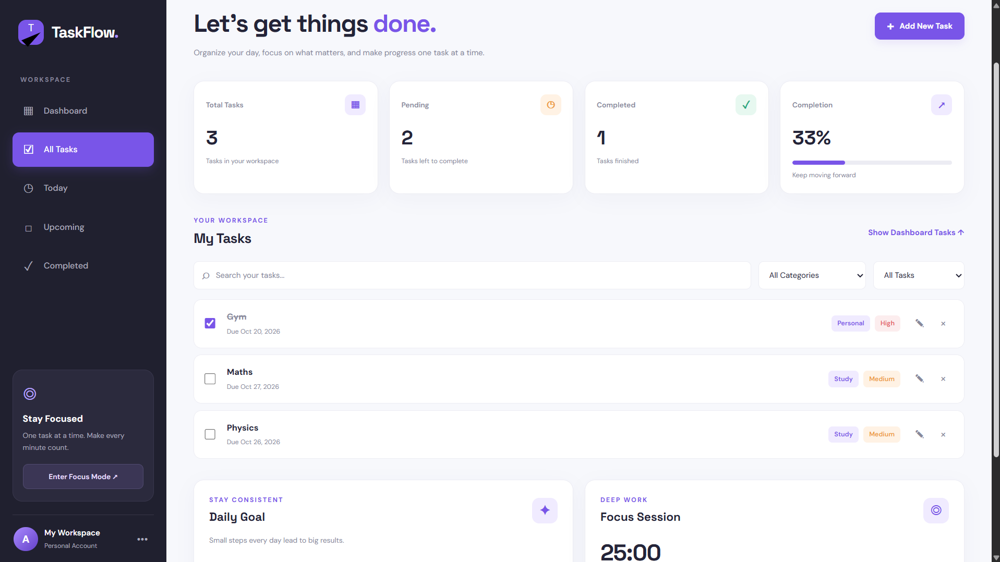

# ✨ TaskFlow

A modern and responsive task management dashboard to organize tasks, track productivity, and stay focused.

---

## 🚀 Live Demo

👉 https://taskflow-ulik.onrender.com/

---

## ✨ Features

- ➕ Create, edit, and delete tasks
- ✅ Mark tasks as completed
- 🏷️ Organize tasks by categories
- 🎯 Set task priorities
- 📅 Manage task due dates
- 🔍 Search and filter tasks
- 📊 Track productivity and task completion
- 🏆 Daily goal tracking
- ⏱️ Pomodoro focus timer
- 🌙 Dark and light mode
- 💾 Data persistence using Local Storage
- 📱 Responsive design for mobile and desktop

---

## 🛠️ Tech Stack

- HTML5
- CSS3
- JavaScript
- Local Storage
- Render

---

## 📸 Project Preview

---

## 👨‍💻 Author

**Anish Kumar Gupta**

[GitHub Profile](https://github.com/akg147anish-hub)